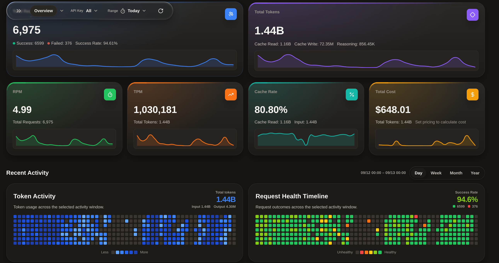
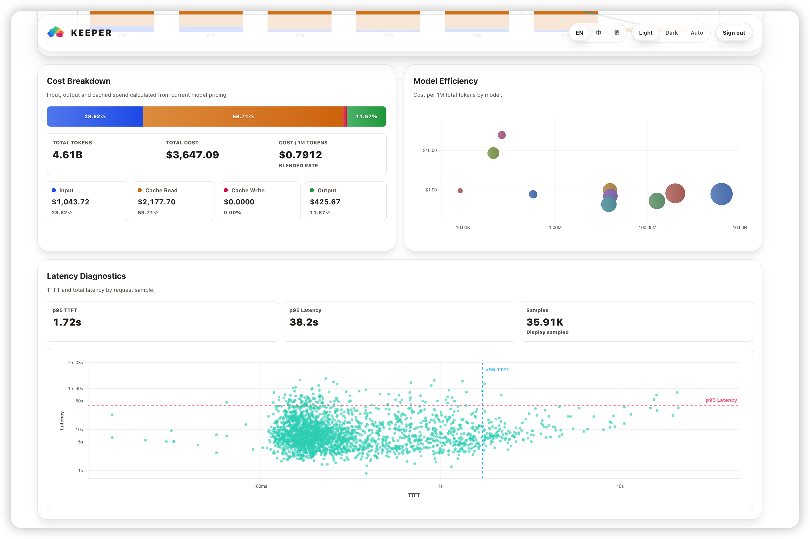
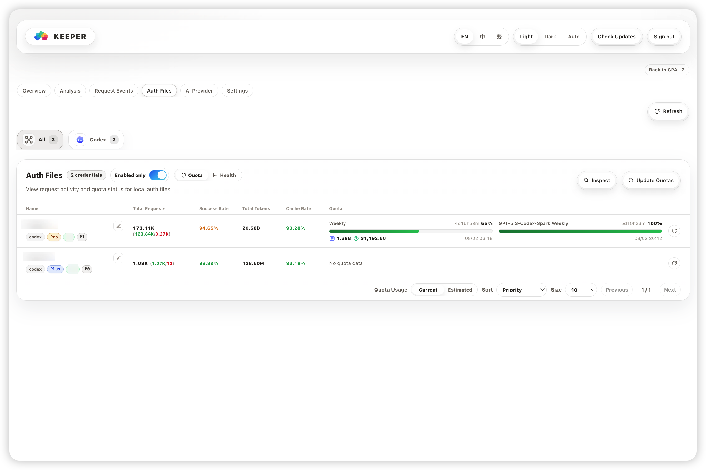
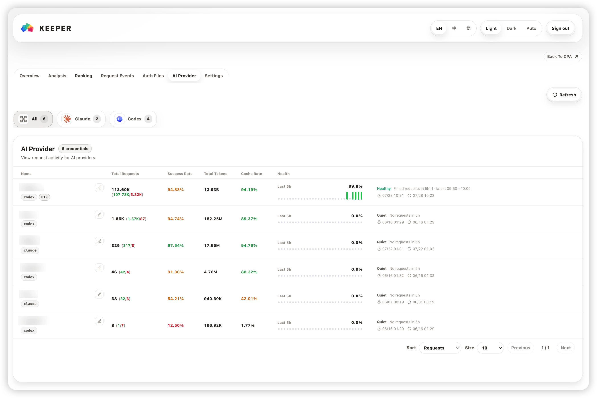
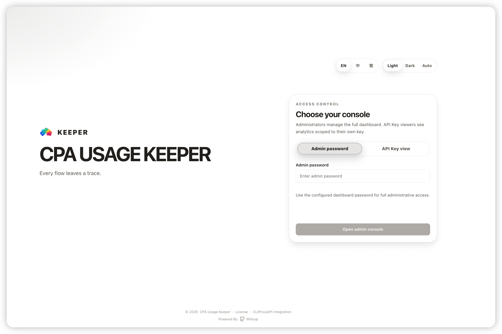

<p align="center">
  <picture>
    <source media="(prefers-color-scheme: dark)" srcset="./assets/keeper-logo-dark.svg" />
    <source media="(prefers-color-scheme: light)" srcset="./assets/keeper-logo-light.svg" />
    
  </picture>
</p>

<p align="center">
  <a href="./README.md">English</a> ｜ <a href="./README.zh.md"><strong>简体中文</strong></a> ｜ <a href="./README.ko.md">한국어</a>
</p>

<h1 align="center">CPA Usage Keeper</h1>

<p align="center">万千流转，皆有迹可循。</p>

<p align="center">
  <a href="https://github.com/Willxup/cpa-usage-keeper/releases/latest"></a>
  <a href="https://github.com/Willxup/cpa-usage-keeper/actions/workflows/ci.yml"></a>
  <a href="https://github.com/Willxup/cpa-usage-keeper/pkgs/container/cpa-usage-keeper"></a>
  <a href="https://github.com/Willxup/homebrew-cpa-usage-keeper"></a>
  <a href="https://github.com/Willxup/cpa-usage-keeper/releases/latest"></a>
  <a href="https://github.com/Willxup/cpa-usage-keeper/releases/latest"></a>
  <a href="https://github.com/Willxup/cpa-usage-keeper/releases/latest"></a>
  <a href="./LICENSE"></a>
</p>

CPA Usage Keeper 是面向 [CLIProxyAPI（CPA）](https://github.com/router-for-me/CLIProxyAPI) 的独立用量持久化与分析面板。它将 CPA 用量保存到 SQLite，自动拉取 CPA 配置和凭证数据，并提供用量、成本、请求健康、限额及模型/API 统计。

## 界面预览

<p align="center">
  <picture>
    <source media="(prefers-color-scheme: dark)" srcset="./assets/screenshots/overview-dark.png" />
    <source media="(prefers-color-scheme: light)" srcset="./assets/screenshots/overview-light.png" />
    
  </picture>
  <picture>
    <source media="(prefers-color-scheme: dark)" srcset="./assets/screenshots/analysis-dark.png" />
    <source media="(prefers-color-scheme: light)" srcset="./assets/screenshots/analysis-light.png" />
    
  </picture>
</p>
<p align="center">
  <picture>
    <source media="(prefers-color-scheme: dark)" srcset="./assets/screenshots/auth-files-dark.png" />
    <source media="(prefers-color-scheme: light)" srcset="./assets/screenshots/auth-files-light.png" />
    
  </picture>
  <picture>
    <source media="(prefers-color-scheme: dark)" srcset="./assets/screenshots/ai-provider-dark.png" />
    <source media="(prefers-color-scheme: light)" srcset="./assets/screenshots/ai-provider-light.png" />
    
  </picture>
</p>
<p align="center">
  <picture>
    <source media="(prefers-color-scheme: dark)" srcset="./assets/screenshots/login-dark.png" />
    <source media="(prefers-color-scheme: light)" srcset="./assets/screenshots/login-light.png" />
    
  </picture>
</p>

## 功能特性

- [Keeper 导出运维手册](docs/keeper-export.md) — 迁移、凭据、接收、恢复与发布操作。
- **保留历史**：持续保存 CPA 用量到 SQLite，并支持定时备份。
- **看清花费**：按模型、API Key 和提供商分析用量、缓存及估算成本。
- **定位问题**：查看和导出请求明细，通过成功率、首字延迟（TTFT）和总耗时分析请求表现。
- **掌握额度**：查看凭证健康与剩余限额，支持限额刷新、优先级编辑和 Codex 限额历史。
- **按需分享**：为单个 CPA API Key 提供独立的只读用量视图。

此外，还支持通过 CPA 插件嵌入 CPAMC。可使用 Docker Compose、Homebrew 或二进制部署，登录保护默认开启。

## 赞助与特别感谢

- 感谢 [CLIProxyAPI（CPA）](https://github.com/router-for-me/CLIProxyAPI) 提供本项目所依赖的上游 CPA 基础与数据来源。
- 感谢 [@YouShouldBetOnMe](https://github.com/YouShouldBetOnMe) 对 CPA Usage Keeper 的支持。
- 感谢 CPA 讨论组（QQ群组）的讨论与反馈。

## 快速开始

> Keeper 支持 CPA v8.0.12+。请开启 CPA 使用统计，将 `observability.usage.usage-statistics-enabled` 设为 `true`。

> 同一 CPA 接入多个 usage 采集服务时，请确保均使用订阅模式，否则可能导致收数中断或数据不完整。

Docker Compose 是推荐部署方式：首次部署可同时运行 CPA + Keeper，已有 CPA 时则使用 Keeper-only Compose。

| 场景 | 推荐方式 | 架构 |
| --- | --- | --- |
| 首次部署 CPA + Keeper | [Docker Compose：CPA + Keeper](#docker-compose推荐) | `linux/amd64`、`linux/arm64` |
| 已有 CPA | [Docker Compose：仅 Keeper](#docker-compose推荐) | `linux/amd64`、`linux/arm64` |
| 已有 CPA，偏好 Docker CLI | [Docker](#dockercpa-已在宿主机运行) | `linux/amd64`、`linux/arm64` |
| macOS | [Homebrew](#macos-homebrew) | `amd64`、`arm64` |
| Linux 不使用容器 | [Linux 二进制](#linux-二进制) | `amd64`、`arm64` |
| Windows | [Windows Binary](#windows-binary) | `amd64`、`arm64` |

登录保护默认启用。启动 Keeper 前请配置 `LOGIN_PASSWORD`；只有部署环境已可靠隔离访问时，才显式设置 `AUTH_ENABLED=false`。

## Benchmark

`linux/amd64` 生产型容量测试覆盖持续 ingestion、Dashboard 延迟、CPU 利用率和 Keeper cgroup 峰值内存，完整结果见 [容量 Benchmark 报告](./internal/benchmark/reports/capacity/README.zh.md)。

<details>
<summary>开发者参考：项目结构、本地运行与测试</summary>

## 项目结构

```text
cmd/server/              应用入口
internal/api/            HTTP 路由与处理器
internal/app/            应用装配与启动
internal/auth/           Session 与访问控制
internal/poller/         CPA 用量与配置同步
internal/repository/     SQLite 持久化与聚合
internal/service/        用量、定价与身份服务
internal/quota/          Provider 限额刷新与巡检
internal/benchmark/      容量套件、报告、manifest 与历史 Go microbenchmark
deploy/                  部署模板
web/                     React + TypeScript 前端
```

## 本地开发

### 前置依赖

- Go 1.26+
- Node.js 24+
- npm
- 一个可用的 [CLIProxyAPI（CPA）](https://github.com/router-for-me/CLIProxyAPI) 实例

### 本地运行

1. 将 `.env.example` 复制为 `.env`，至少设置 `CPA_BASE_URL` 和 `CPA_MANAGEMENT_KEY`。

```bash
cp .env.example .env
vim .env
```

2. 启动后端。

```bash
go run ./cmd/server/main.go
```

3. 在另一个终端安装前端依赖并启动开发服务器。

```bash
npm --prefix ./web ci
npm --prefix ./web run dev -- --host 127.0.0.1
```

打开 `http://127.0.0.1:5173`。前端默认将 `/api` 代理到 `http://127.0.0.1:8080`；后端使用其它端口时可通过 `VITE_API_PROXY_TARGET` 覆盖。

### 测试

运行完整验证：

```bash
make verify
```

也可以分别运行：

```bash
go test ./cmd/... ./internal/...
npm --prefix ./web run test
npm --prefix ./web run lint
npm --prefix ./web run typecheck
npm --prefix ./web run build
```

### 图表时间处理

- 使用响应/配置时区。自然日使用 `internal/timeutil.CivilDate` 和 `DayBounds`，滚动窗口使用真实时长；自然日不一定是24小时。
- 通过 repository 的桶读取适配方法查询现有增量表。Overview 与 Latency 的小时锚点不同；Activity 保留既有364格及存量结束边界。查询修复不得改变写入桶或重切已有聚合。
- 原始事件时间条件与真实时间过滤复用 `internal/repository/usage_event_time_read.go`。普通查询使用有界分段，近期缓存启动/重载使用开放上界读取；字段投影与生命周期逻辑保留在调用方。
- 桶身份使用真实时刻或完整日期，不使用格式化钟面标签。时间戳按真实时间排序，日桶速率使用完整自然日的实际分钟数。
- 复用 `web/src/utils/usage/timeLabels.ts` 获取时区日期部分、区分回拨时的重复钟面。保留各图表原有语言、精度、fallback和补点规则，仅对歧义钟面补offset。
- 同时验证上海普通日期和DST跳时/回拨，覆盖浏览器与响应时区不同的情况；保留现有图表样式和生命周期行为。

</details>

## 部署方式

### Docker Compose（推荐）

Docker Compose 同时推荐用于 CPA + Keeper 联合部署和 Keeper 单独部署。

#### CPA + Keeper

将下面内容保存为 `docker-compose.yml`，并替换管理密钥和登录密码：

```yaml
services:
  cli-proxy-api:
    image: eceasy/cli-proxy-api:latest
    container_name: cli-proxy-api
    restart: unless-stopped
    ports:
      - "8317:8317"
      - "1455:1455"
    volumes:
      - ./cpa/config.yaml:/CLIProxyAPI/config.yaml
      - ./cpa/auths:/root/.cli-proxy-api
      - ./cpa/logs:/CLIProxyAPI/logs
    networks:
      - cpa-network

  cpa-usage-keeper:
    image: ghcr.io/willxup/cpa-usage-keeper:latest
    container_name: cpa-usage-keeper
    restart: unless-stopped
    depends_on:
      - cli-proxy-api
    ports:
      - "8080:8080"
    environment:
      TZ: Asia/Shanghai # 设置容器时区，日志时间会按该时区显示。
      CPA_BASE_URL: http://cli-proxy-api:8317
      CPA_MANAGEMENT_KEY: replace-with-your-management-key
      REDIS_QUEUE_ADDR: cli-proxy-api:8317
      AUTH_ENABLED: true
      LOGIN_PASSWORD: ${KEEPER_LOGIN_PASSWORD:?set KEEPER_LOGIN_PASSWORD}
    volumes:
      - ./keeper:/data
    networks:
      - cpa-network

networks:
  cpa-network:
    driver: bridge
```

启动前请在 shell 或 Compose `.env` 文件中设置 `KEEPER_LOGIN_PASSWORD`。

```bash
curl -fL https://raw.githubusercontent.com/Willxup/cpa-usage-keeper/main/deploy/docker-compose.full.example.yml \
  -o docker-compose.yml
```

以上下载命令用于首次部署；已有配置时请直接编辑，避免覆盖。

**2. 填写 CPA 和 Keeper 配置**

按下表编辑 `cpa/config.yaml` 中的已有配置项，保留 YAML 层级与缩进；表中的点号表示嵌套路径，不是要新增的 YAML 键名：

| 配置项 | 设置说明 |
| --- | --- |
| `management.allow-remote` | 改为 `true`，允许 Keeper 从另一个容器访问 CPA 管理功能。 |
| `management.secret-key` | 设置私有的管理密钥，并在 `docker-compose.yml` 的 `CPA_MANAGEMENT_KEY` 中填写同一个原始密钥。 |
| `observability.usage.usage-statistics-enabled` | 改为 `true`，开启使用统计。 |
| `access.api-keys` | 将示例密钥替换为自己的客户端调用密钥；这不是 CPA 管理密钥或 Keeper 登录密码。 |

保留 `server.host` 为空字符串、`server.port` 为 `8317`、`oauth.auth-dir` 为 `"~/.cli-proxy-api"`，以匹配模板中的容器网络及目录挂载。

编辑下载的 `docker-compose.yml`，在 Keeper 的 `environment` 中填写两项：

- `CPA_MANAGEMENT_KEY`：填写 CPA 中设置的同一个原始管理密钥。
- `LOGIN_PASSWORD`：将空字符串 `""` 替换为你自己的 Keeper 登录密码。

也可将配置写入 `./keeper/.env`，模板会通过可选的 `env_file` 读取；文件不存在时不影响 Compose 启动。同名变量以 `environment` 为准，如改用文件中的值，请删除 `environment` 中对应项，包括空值占位。

**3. 启动并访问**

```bash
docker compose up -d
```

访问 `http://服务器地址:8080`，使用刚设置的 Keeper 登录密码登录。停止服务时执行 `docker compose down`。

首次部署还需在 CPA 中添加模型凭证，调用模型后才会产生使用记录。

CPA 数据保存在 `./cpa`，Keeper 数据保存在 `./keeper`。

#### Keeper Only

CPA 已经部署好时，直接使用仓库中的 Keeper-only Compose 模板：

```bash
cp deploy/docker-compose.example.yml docker-compose.yml
cp .env.example .env
vim .env
```

CPA 运行在 Docker 宿主机上时，可从以下配置开始：

```env
CPA_BASE_URL=http://host.docker.internal:8317
CPA_MANAGEMENT_KEY=replace-with-your-management-key
AUTH_ENABLED=true
LOGIN_PASSWORD=
```

启动容器前请设置私有的 `LOGIN_PASSWORD`。

无论 CPA 位于 Docker 宿主机还是其他主机，都需允许远程管理，并监听 Keeper 容器可访问的地址；只监听 `127.0.0.1` 时容器无法连接。设置 `management.allow-remote: true`，并检查 `server.host`。

运行 `docker compose up -d` 启动 Keeper，使用 `docker compose down` 停止。

模板默认将 Keeper 数据保存在 `./data`。

#### 查看日志与更新

两种 Compose 部署均可在部署目录中查看 Keeper 日志：

```bash
docker compose logs --tail=100 -f cpa-usage-keeper
```

更新 Keeper 时，保留配置和数据目录，执行：

```bash
docker compose pull cpa-usage-keeper
docker compose up -d cpa-usage-keeper
```

#### 启动后没有数据？

- 确认 CPA 使用统计已开启：`observability.usage.usage-statistics-enabled` 为 `true`。
- 确认 Keeper 能访问 `CPA_BASE_URL`，且 `CPA_MANAGEMENT_KEY` 与 CPA 管理密钥一致。
- 确认 CPA 已产生新的模型请求；仍没有数据时，用上面的日志命令检查连接或认证错误。

### Docker（CPA 已在宿主机运行）

偏好使用 `docker run` 时，复用上面 Keeper-only Compose 的 `.env` 配置：

```bash
docker run -d \
  --name cpa-usage-keeper \
  --add-host=host.docker.internal:host-gateway \
  -p 8080:8080 \
  -v "$(pwd)/keeper:/data" \
  --env-file .env \
  ghcr.io/willxup/cpa-usage-keeper:latest
```

### macOS Homebrew

Homebrew 是 macOS 推荐安装方式：

```bash
brew tap Willxup/cpa-usage-keeper
brew install cpa-usage-keeper
```

设置 `CPA_BASE_URL`、`CPA_MANAGEMENT_KEY` 和私有的 `LOGIN_PASSWORD`，然后启动服务：

```bash
vim "$(brew --prefix)/etc/cpa-usage-keeper.env"
brew services start cpa-usage-keeper
```

升级和服务管理命令：

```bash
brew services list
brew services restart cpa-usage-keeper
brew update
brew upgrade cpa-usage-keeper
```

数据保存在 `$(brew --prefix)/var/cpa-usage-keeper`，日志写入 `$(brew --prefix)/var/log/`。

### Linux 二进制

从 [Releases](https://github.com/Willxup/cpa-usage-keeper/releases/latest) 下载 `linux_amd64` 或 `linux_arm64` 压缩包，然后解压并运行：

```bash
mkdir -p cpa-usage-keeper
tar -xzf ./cpa-usage-keeper_*_linux_*.tar.gz -C cpa-usage-keeper --strip-components=1
cd cpa-usage-keeper
cp .env.example .env
vim .env
./cpa-usage-keeper
```

#### systemd

Linux 压缩包内置 service 模板。请在解压后的目录中运行：

```bash
sudo cp cpa-usage-keeper.service /etc/systemd/system/cpa-usage-keeper.service
sudo sed -i "s|__CPA_USAGE_KEEPER_DIR__|$(pwd)|g" /etc/systemd/system/cpa-usage-keeper.service
sudo systemctl daemon-reload
sudo systemctl enable --now cpa-usage-keeper
```

```bash
sudo systemctl status cpa-usage-keeper
sudo journalctl -u cpa-usage-keeper -f
sudo systemctl restart cpa-usage-keeper
```

### 命令行参数

二进制支持以下可选启动参数：

```bash
cpa-usage-keeper --host 127.0.0.1 # 仅为当前进程覆盖 APP_HOST。
cpa-usage-keeper -v               # 输出构建版本并退出；也支持 --version。
```

### Windows Binary

从 [Releases](https://github.com/Willxup/cpa-usage-keeper/releases/latest) 下载 `windows_amd64` 或 `windows_arm64` ZIP 并解压。在 PowerShell 中进入解压目录后运行：

```powershell
Copy-Item .env.example .env
notepad .env
.\cpa-usage-keeper.exe
```

启动前请设置 `CPA_BASE_URL`、`CPA_MANAGEMENT_KEY` 和私有的 `LOGIN_PASSWORD`。认证默认启用；只有隔离部署才显式设置 `AUTH_ENABLED=false`。

## 配置

复制配置模板：

```bash
cp .env.example .env
```

新手部署时优先看“最小必填”和“Web 访问与反代”两组，其它配置保持默认即可。

### 最小必填

| 变量 | 必填 | 默认值 | 说明 |
| --- | --- | --- | --- |
| `CPA_BASE_URL` | 是 | - | Keeper 服务端访问 CPA 的地址。Docker Compose 内通常是 `http://cli-proxy-api:8317`，可以是内网地址或容器服务名 |
| `CPA_MANAGEMENT_KEY` | 是 | - | CPA management key，用于读取 CPA 管理接口数据 |

### Web 访问与反代

| 变量 | 必填 | 默认值 | 说明 |
| --- | --- | --- | --- |
| `APP_HOST` | 否 | 所有接口 | Keeper HTTP 监听主机；原生部署仅允许本机访问时可设为 `127.0.0.1` |
| `APP_PORT` | 否 | `8080` | Keeper HTTP 监听端口 |
| `APP_BASE_PATH` | 否 | 根路径 | Keeper 子路径部署前缀，例如 `/keeper`；留空表示部署在 `/` |
| `CPA_PUBLIC_URL` | 否 | 当前浏览器同源根路径 | 浏览器访问 CPA 的公开地址，用于“返回 CPA”跳转和 CPAMC frame 信任来源 |
| `TRUSTED_PROXY_CIDRS` | 否 | 仅本机 loopback | 允许提供 `X-Forwarded-For` 的额外反向代理 CIDR，多个值用逗号分隔 |

- 启动参数 `--host` 的优先级高于 `APP_HOST`。两者都未设置时，Keeper 保持现有行为，监听所有可用网络接口。
- Docker/Compose 请保持 `APP_HOST` 为空；如需仅允许 Docker 宿主机访问，请将端口发布为 `127.0.0.1:8080:8080`。
- `APP_BASE_PATH` 必须为空或以 `/` 开头；`/cpa/` 会规范为 `/cpa`。
- `CPA_BASE_URL` 是服务端访问 CPA 的地址，可以使用内网地址或 Docker 服务名。
- `CPA_PUBLIC_URL` 控制浏览器跳转和跨域 CPAMC frame 信任。同源且 CPA 位于 `/management.html` 时可留空；域名、端口或路径不同时应设置公开 CPA 地址。
- Keeper 只信任本机 loopback 和 `TRUSTED_PROXY_CIDRS` 提供的 `X-Forwarded-For`；直连客户端不能通过该请求头切换登录限流来源。只配置实际代理地址或网段，全网 CIDR 会被拒绝。

跨域嵌入 CPAMC 时，`CPA_PUBLIC_URL` 必须是带 host 的完整 `http://` 或 `https://` URL；相对路径只影响浏览器跳转。

### 登录保护

| 变量 | 必填 | 默认值 | 说明 |
| --- | --- | --- | --- |
| `AUTH_ENABLED` | 否 | `true` | 是否启用登录保护 |
| `LOGIN_PASSWORD` | 鉴权启用时必填 | - | 登录密码 |
| `AUTH_SESSION_TTL` | 否 | `168h` | 登录 session 有效时长 |

### OIDC 管理员登录

Keeper 可通过一个 OpenID Connect 身份平台登录管理员。在平台中注册带客户端密钥的服务器端客户端，启用 Authorization Code Flow 和 PKCE S256，并精确注册公开回调地址：

```text
https://keeper.example.com/<APP_BASE_PATH>/api/v1/auth/oidc/callback
```

根路径部署省略 `<APP_BASE_PATH>/`。仍须保留 `AUTH_ENABLED=true` 和私有的 `LOGIN_PASSWORD`；身份平台暂时不可用时，密码登录继续可用。

| 变量 | 默认值 | 说明 |
| --- | --- | --- |
| `AUTH_OIDC_ENABLED` | `false` | 在独立页面的管理员登录页签启用 OIDC |
| `AUTH_OIDC_PROMPT_LOGIN` | `true` | 发起登录时传递 `prompt=login` 要求重新认证；设为 `false` 时不传此参数，允许复用平台已有登录状态 |
| `AUTH_OIDC_ISSUER` | 空 | 精确的 HTTP/HTTPS Issuer，包含平台租户路径 |
| `AUTH_OIDC_CLIENT_ID` | 空 | 已注册的服务器端客户端 ID |
| `AUTH_OIDC_CLIENT_SECRET` | 空 | 已注册的客户端密钥 |
| `AUTH_OIDC_REDIRECT_URL` | 空 | 精确的 Keeper 公开回调地址，包含部署子路径 |
| `AUTH_OIDC_ALLOWED_SUBJECTS` | `[]` | 可选的 JSON 字符串数组，精确匹配区分大小写的 `sub` |

例如 `AUTH_OIDC_ALLOWED_SUBJECTS='["user-123","user,456"]'`。请使用平台实际签发给此客户端的 `sub`，不要替换成邮箱、显示名或猜测的平台用户 ID。缺省或空数组将应用准入交给身份平台：**通过此客户端认证的所有用户都会成为 Keeper 管理员**，请在平台中配置该应用的访问策略。邮箱和姓名仅用于显示。旧的 `AUTH_OIDC_ALLOWED_USERS` 非空时会阻止启动并提示迁移；删除旧配置前，须换成实际 subject，或在身份平台实施相应访问限制。

每次新发起 OIDC 登录时，默认通过 `prompt=login` 要求重新认证，具体认证方式由身份平台决定。设置 `AUTH_OIDC_PROMPT_LOGIN=false` 可允许复用平台现有登录状态。此设置不会撤销已建立的 Keeper 会话，也不会退出身份平台。

Keeper 使用标准 Discovery、JWKS、`openid profile email`、有签名的 ID Token、nonce、浏览器绑定及 PKCE S256。客户端密钥认证自动处理 `client_secret_basic` 和 `client_secret_post`。元数据端点可位于不同主机，并使用显式 HTTP/HTTPS 地址和已有查询参数。公共客户端、`form_post`、JWE、JWT Client Authentication、多 Issuer 选择和全局单点注销不属于本功能范围。

推荐 Issuer、元数据端点和 Keeper 均使用 HTTPS。明确配置的 HTTP 地址直接生效，无需额外开关，也不限于 localhost；HTTP Discovery/JWKS 无法保护身份信任起点，HTTP Keeper Cookie 没有传输加密。HTTPS 失败不会自动降级 HTTP 或跳过证书验证。内部 CA 需要加入服务使用的受信任证书链。配置或元数据使用 HTTP 时会记录提示；HTTP 支持是对 Discovery 的 HTTPS 要求的兼容扩展，不会让明文链路获得传输安全。

Issuer 使用平台公布的身份地址，须与 Discovery 和 ID Token 的 `iss` 精确一致。Keeper 服务端需要能访问 Discovery、Token 和 JWKS 端点，浏览器需要能访问授权端点；这些端点不要求同一主机。除非平台本身公布的身份地址就是容器内部地址，否则不能将 Issuer 随意替换为内部地址。

请从与回调相同的公开 origin 打开 Keeper。HTTPS 反向代理应保留公开 `Host` 和 `X-Forwarded-Proto`（或提供 `X-Forwarded-Host`），并在 `TRUSTED_PROXY_CIDRS` 中配置实际代理网段。API Key 页签和 CPAMC 嵌入模式不显示 OIDC。登录成功会恢复合法的站内页面及查询参数。未完成登录保存在当前进程内，五分钟过期；重启中断的登录可以重新点击按钮发起。请在代理访问日志中过滤回调查询参数，其中包含短期授权码和 state。

取消授权和身份平台故障不计入 OIDC 的来源认证失败额度；现有全局登录请求频率限制仍然生效。

登录后的会话沿用 `AUTH_SESSION_TTL`，在会话管理中显示 **OIDC 登录**。退出只撤销 Keeper 本地会话；当 `AUTH_OIDC_PROMPT_LOGIN=false` 时，再次登录仍可能由身份平台自动认证。关闭 OIDC、切换 Issuer/Client ID 或收紧 subject 列表后，配置随重启生效，在业务就绪前永久撤销受影响会话，无需旧浏览器再次访问或打开会话管理页；仅更换客户端密钥不会撤销现有会话。平台侧删号或收紧访问权限不会自动撤销 Keeper 已有会话，需要在会话管理中撤销或等待 TTL 到期。回退到不支持 OIDC 的 Keeper 版本前，先用新版本撤销所有 OIDC 会话，再停止 Keeper 并替换程序；新增可空数据库列可以保留。

### 时区与请求行为

| 变量 | 必填 | 默认值 | 说明 |
| --- | --- | --- | --- |
| `TZ` | 否 | `Asia/Shanghai` | 统计和展示使用的时区；Today、按天统计、页面时间、日志时间和每日清理时间都会按这个时区计算 |
| `REQUEST_TIMEOUT` | 否 | `30s` | 请求 CPA HTTP 接口和 Redis 队列的超时时间 |
| `TLS_SKIP_VERIFY` | 否 | `false` | 跳过 CPA HTTPS 和 Redis 队列 TLS 的证书验证；仅在使用自签名证书时启用 |

### Credentials 限额刷新

Credentials 定时限额刷新在 Credentials 巡检弹窗的小齿轮中配置。设置保存在本地 SQLite，不依赖页面保持打开。

| 变量 | 必填 | 默认值 | 说明 |
| --- | --- | --- | --- |
| `QUOTA_REFRESH_WORKER_LIMIT` | 否 | `10` | 手动刷新和定时刷新共用的 Credentials 限额刷新队列最大并发数，最大 `100` |
| `QUOTA_UPSTREAM_RESPONSES_ENABLED` | 否 | `false` | 缓存每个凭证最近一次限额查询的原始上游响应，并通过 quota task/cache API 返回，供浏览器 Network 面板排障；响应可能包含账号数据 |

### Redis 队列高级配置

| 变量 | 必填 | 默认值 | 说明 |
| --- | --- | --- | --- |
| `REDIS_QUEUE_ADDR` | 否 | 从 `CPA_BASE_URL` 推导 | 显式设置时优先使用该地址；留空时沿用 `CPA_BASE_URL` 的主机和显式端口，未指定端口时使用 `8317`。独立地址填写 `host:port` |
| `REDIS_QUEUE_TLS` | 否 | `false` | 设为 `true` 强制启用 Redis 队列 TLS；未指定队列地址时，默认跟随 `CPA_BASE_URL` 的协议。`false` 不会覆盖自动推导的 TLS 设置。 |
| `REDIS_QUEUE_BATCH_SIZE` | 否 | `10000` | 每次最多拉取的队列记录数 |
| `REDIS_QUEUE_IDLE_INTERVAL` | 否 | `1s` | 队列为空时的检查间隔 |

### 存储、日志与备份

| 变量 | 必填 | 默认值 | 说明 |
| --- | --- | --- | --- |
| `WORK_DIR` | 否 | `./data` | 应用工作目录；数据库、日志和备份默认分别写入 `app.db`、`logs/`、`backups/` |
| `LOG_LEVEL` | 否 | `info` | 日志级别 |
| `LOG_FILE_ENABLED` | 否 | `true` | 是否写入持久化日志文件 |
| `LOG_RETENTION_DAYS` | 否 | `7` | 综合日志保留历史天数，并额外保留当天；`0` 表示不自动清理。仅错误日志固定保留历史 30 天及当天 |
| `BACKUP_ENABLED` | 否 | `true` | 是否启用定时数据库备份 |
| `BACKUP_INTERVAL` | 否 | `24h` | 数据库备份间隔 |
| `BACKUP_RETENTION_DAYS` | 否 | `7` | 备份保留天数 |
| `BACKUP_COMPRESS` | 否 | `true` | 备份完成后 gzip 压缩保存（`.db.gz`），体积约为未压缩的五分之一 |
| `USAGE_EVENTS_HOT_RETENTION_DAYS` | 否 | `90` | 热表在归档前保留 `usage_events` 的本地自然日数，必须为正 |
| `USAGE_RAW_RETENTION_DAYS` | 否 | `0` | 原始请求总保留天数，仅清理归档表；`0` 永久保留。小于 `USAGE_EVENTS_HOT_RETENTION_DAYS` 时按 `0` 处理并记录 warning，不影响启动 |
| `ERROR_EVENTS_RETENTION_DAYS` | 否 | `30` | 凭证 `error_events` 保留的本地自然日数；`0` 表示全部保留 |
| `USAGE_OVERVIEW_HOURLY_RETENTION_DAYS` | 否 | `90` | 小时级 Overview 汇总保留的本地自然日数；`0` 表示全部保留，长范围查询由每日汇总承担 |

Keeper 每天按配置时区在 04:30 自动归档超过 `USAGE_EVENTS_HOT_RETENTION_DAYS`（默认 90）个本地自然日的原始请求记录，归档默认永久保留。将 `USAGE_RAW_RETENTION_DAYS` 设为不小于热表窗口后，每日归档完成后会分批删除超过总保留天数的归档记录，期限按请求发生时间及配置时区的自然日计算。`ERROR_EVENTS_RETENTION_DAYS` 与 `USAGE_OVERVIEW_HOURLY_RETENTION_DAYS` 分别限制凭证错误历史与小时级汇总。常规页面不直接查询归档明细；删除的原始记录无法用于后续历史重算；超过保留期的小时级汇总只对长于该保留期的自定义范围的起止部分天有意义（完整自然日由每日汇总承担）；删除后 SQLite 文件不一定立即缩小，当空闲页达到 256 MiB 且占数据库 10% 时由条件式整理回收。归档记录存放在 `usage_events_archive` 冷表中。

启用文件日志后，`cpa-usage-keeper-YYYY-MM-DD.log` 会记录所有已输出级别；error、fatal 和 panic 级别还会同时写入 `cpa-usage-keeper-error-YYYY-MM-DD.log`，该文件固定保留历史 30 个本地自然日及当天。

### v1 升级 v2 失败后的回退

Keeper 会在迁移 v1 数据前备份数据库。如果迁移失败且备份验证通过，日志会输出英文回退说明及备份路径 `backup_path`。

1. 停止 Keeper v2，保留故障数据库及其可能存在的 `-wal`、`-shm` 文件。
2. 将升级前备份复制为独立数据目录中的 `<新 WORK_DIR>/app.db`，即将备份副本重命名为 `app.db`。保留原备份，不要混入故障数据库的文件。
3. 安装 Keeper v1，将 `WORK_DIR` 设为该新目录。Docker 默认配置下，将新目录挂载到 `/data`，使恢复文件在容器内的路径为 `/data/app.db`。不要让 v1 直接打开迁移了一部分的数据库。

恢复后的数据回到备份时点，不包含此后收到的用量。如果没有可验证的备份，应先找到并核实一份升级前备份，再尝试回退。

### 内置 HTTPS

| 变量 | 必填 | 默认值 | 说明 |
| --- | --- | --- | --- |
| `TLS_ENABLED` | 否 | `false` | 是否让 Keeper 自己启用 HTTPS/TLS |
| `TLS_CERT_FILE` | 启用 TLS 时必填 | - | HTTPS 证书文件路径 |
| `TLS_KEY_FILE` | 启用 TLS 时必填 | - | HTTPS 私钥文件路径 |

通常建议在 nginx、Caddy 等反向代理层处理 HTTPS。只有需要 Keeper 进程直接提供 HTTPS 时，才设置 `TLS_ENABLED=true`，并填写 `TLS_CERT_FILE` 和 `TLS_KEY_FILE`；相对路径会按 `.env` 所在目录解析。

安全与数据说明：

- 浏览器 API 会脱敏 key 类字段，但 SQLite 数据库及其未加密备份仍包含原始数据。
- 认证默认启用。若显式关闭，请在部署边界限制 Keeper 访问；公网访问应在反向代理层启用 HTTPS。
- 登录 session hash 会保存在 SQLite 中，直到用户退出或超过 `AUTH_SESSION_TTL`。
- CPAMC 使用独立的 embed session：优先使用 `HttpOnly` Cookie，不可用时回退到保存在浏览器 session storage 中的单标签页请求头 token。
- 同源嵌入默认可用；跨域嵌入时，将 `CPA_PUBLIC_URL` 设置为用于 `frame-ancestors` 的公开 CPA/CPAMC 来源。
- Redis inbox 消息成功后保留到当天结束，失败后保留 7 天。

## Nginx 反向代理

部署到 `/cpa` 时设置 `APP_BASE_PATH=/cpa`，并在反向代理中保留该前缀：

```nginx
location /cpa/ {
    proxy_pass http://127.0.0.1:8080;
    proxy_set_header Host $host;
    proxy_set_header X-Forwarded-Proto $scheme;
    proxy_set_header X-Forwarded-For $proxy_add_x_forwarded_for;
}
```

上面的本机 Nginx 配置无需额外设置 Keeper。若反向代理通过容器或其它主机访问 Keeper，或反向代理前面还有 Cloudflare 等 CDN，请加入准确的代理网段，例如 `TRUSTED_PROXY_CIDRS=172.18.0.0/16`。

CPA 与 Keeper 浏览器同源时，可以不设置 `CPA_PUBLIC_URL`，“返回 CPA”默认使用 `/management.html`。CPA 位于其它域名、端口或路径时，设置公开地址：

```env
CPA_PUBLIC_URL=https://cpa.example.com
```

## License

本项目基于 [MIT License](./LICENSE) 开源。

## Star History

<a href="https://star-history.dera.page/Willxup/cpa-usage-keeper">
 <picture>
   <source media="(prefers-color-scheme: dark)" srcset="https://star-history.dera.page/svg?repos=Willxup/cpa-usage-keeper&theme=dark" />
   <source media="(prefers-color-scheme: light)" srcset="https://star-history.dera.page/svg?repos=Willxup/cpa-usage-keeper" />
   
 </picture>
</a>
